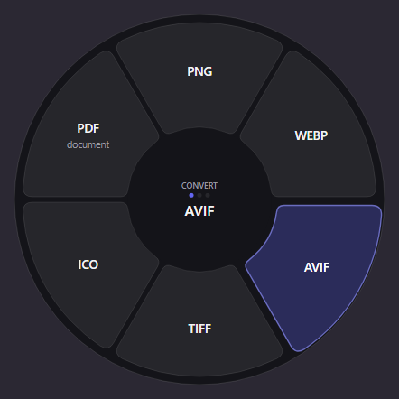
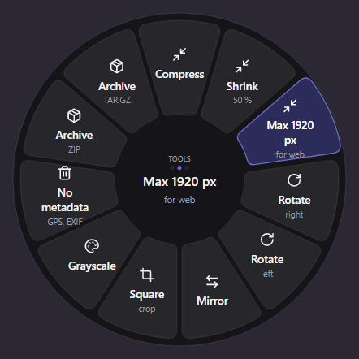
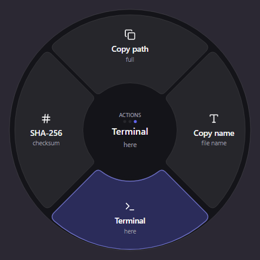
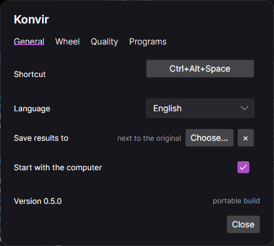

<div align="center">



# Konvir

### Convert any file in two clicks, right where it lies.

Select files, press a shortcut, pick a slice on the wheel. That is the whole program.

**Completely free.** No trial, no key, no ads, no account, no uploads.

[](https://github.com/KROWIEL/konvir/releases/latest/download/Konvir-win-Setup.exe)
[](https://github.com/KROWIEL/konvir/releases/latest/download/Konvir-osx-Setup.pkg)

[](https://github.com/KROWIEL/konvir/releases/latest)
[](https://github.com/KROWIEL/konvir/releases)


[Website](https://krowiel.github.io/konvir/) · English · [Русский](README.ru.md)

</div>

## Why Konvir

- **Free, all of it.** Every format and every feature, with no trial, no paid edition, no licence
  key and nothing to sign up for.
- **Your files stay on your computer.** Everything is converted locally: no cloud, no account, no
  upload. Konvir goes online only to check for its own updates, and to download FFmpeg or Pandoc
  when you press the button for it.
- **A gesture instead of a program.** No window to open, no files to drag into it, no list of a
  hundred formats to scroll. The wheel shows only what fits the selection.
- **Nine kinds of files.** Images (HEIC and 25 raw camera formats included), audio, video, PDF,
  Word, Excel, PowerPoint, e-books, subtitles and archives.
- **A hundred files as easily as one.** Select a whole folder of photos and convert them in one go;
  the jobs queue up and run in the background.
- **Your own slices.** Save a conversion once — "JPEG for the web, metadata stripped" — and it gets
  its own slice on the wheel.
- **Folders that convert by themselves.** Point Konvir at a folder, and every file that lands in it
  is converted without you lifting a finger.
- **Out of your way.** It lives in the tray or the menu bar, follows the system's light or dark
  theme, speaks English and Russian, and updates itself.

## How it works

1. Select files in Explorer, in Finder or on the desktop.
2. Press `Ctrl+Alt+Space` (`⇧⌘Space` on a Mac). The wheel opens under the cursor, showing only what
   fits the selection.
3. Click a slice. Progress appears in a small panel in the corner, and the result lands next to
   the original or in a folder you chose. The panel leaves five seconds after the last job, green
   or red, draining a bar so you can see it going.

With nothing selected the wheel opens empty, as a target: drop files on it and it fills in.

## Three wheels

`Tab` or the scroll wheel switches between them. A wheel with nothing to offer is never shown, so
every slice you can reach does something.

| Convert | Tools | Actions |
|:--:|:--:|:--:|
|  |  |  |
| One format into another | Compress, resize, rotate, strip metadata, archive | Copy path, copy name, open a terminal, SHA-256 |

Right-click a slice to move it to the front of its wheel or take it off entirely. The wheel is
its own settings screen for this: the slice you want gone is the one already under the pointer.
Hidden slices are listed in the settings, where they can be put back.

## Your own slices

A preset is a conversion you describe once and then reach from the wheel: "Web 1920" as JPEG at
quality 82 with the metadata stripped, or "Podcast" as 128 kbit/s MP3. Build them in the settings;
each becomes a slice of its own, named by you.

A preset that changes the format lands on the convert wheel. One that keeps the format — half
size, grayscale, metadata removed — lands on tools, because it edits the file rather than turning
it into something else. Results are named after the preset: `photo (Web 1920).jpg`.

## Folders that convert by themselves

Tell Konvir what a folder is for — "every photo here becomes a JPEG", "every video becomes an
MP4" — and it will do it to whatever lands there, with or without subfolders. Results go into a
`Konvir` folder inside it, so the originals are never touched. A file is only taken once it has
finished arriving: a download in progress or a slow copy is left alone until it is complete.

## Formats

| Kind | In | Out |
|---|---|---|
| Images | JPG, PNG, WEBP, HEIC, TIFF, AVIF, BMP, GIF, SVG, ICO and 25 raw formats | JPG, PNG, WEBP, AVIF, TIFF, ICO, PDF |
| Audio | MP3, M4A, AAC, WAV, FLAC, OGG, OPUS, AIFF, WMA | MP3, M4A, WAV, FLAC, OGG, OPUS, AIFF |
| Video | MP4, MOV, MKV, WEBM, AVI, WMV, FLV, MPG, 3GP, TS | MP4, MOV, MKV, WEBM, GIF, MP3 |
| Documents | DOCX, DOC, ODT, RTF, MD, TXT, HTML, EPUB | DOCX, PDF, ODT, MD, HTML, TXT, EPUB, RTF |
| Spreadsheets | XLSX, XLSM, XLS, ODS, CSV, TSV | XLSX, CSV, TSV, ODS, PDF |
| Slides | PPTX, PPT, ODP | PDF, PNG, JPG, PPTX, ODP |
| Subtitles | SRT, VTT | SRT, VTT, TXT |
| Archives | ZIP, TAR, GZ, BZ2, XZ, RAR, 7Z | ZIP, TAR, TAR.GZ |
| PDF | PDF | PNG, JPG, DOCX, TXT, MD, HTML, EPUB |

Missing a format you need? [Ask for it](https://github.com/KROWIEL/konvir/issues/new?template=idea.yml).

## Settings

<div align="center">

</div>

Five tabs: general, the wheel's own slices, the quality knobs each conversion uses, the external
programs, and the watched folders. Changes take effect as you make them — there is no OK button to
forget.

To change the shortcut, click it and press the combination you want. Anything with at least one
modifier is accepted; if another program already owns it, the window says so instead of leaving
you with a shortcut that does nothing.

## External programs

Media and office conversions are done by three well-known programs, and Konvir runs them as
separate command-line processes:

| Program | Needed for | How to get it |
|---|---|---|
| FFmpeg | Audio and video | The **Install** button downloads it, checksum verified |
| Pandoc | Documents and e-books | The **Install** button: through winget on Windows, downloaded and checksum verified on macOS |
| LibreOffice | DOCX, XLSX, PPTX and ODF | Windows: the **Install** button, through winget. macOS: **Download…** opens libreoffice.org |

Konvir never ships these programs: you install them, on your machine, from their own publishers.
That separation is deliberate and is kept on purpose: their licences stay with them.

Everything else — images, PDF, spreadsheets, subtitles, archives — works with nothing installed.

## Installing

Every build is on the [Releases page](https://github.com/KROWIEL/konvir/releases): an installer and
a portable archive for each system. Konvir checks for newer versions on its own and installs them
when you next close it, keeping your settings.

### Windows

Windows 10 or 11. The installer, `Konvir-win-Setup.exe`, puts Konvir in `%LOCALAPPDATA%\Konvir`,
needs no administrator rights and can start it with the computer.

Konvir is also waiting for review in the Windows Package Manager. Once it is accepted, winget
installs it and checks the download against its own checksum:

```
winget install Konvir.Konvir
```

### About the SmartScreen warning

Downloading the installer yourself gets you "Windows protected your PC". Choose **More info**
and then **Run anyway**.

Konvir is not signed with a code signing certificate yet. We would rather say that plainly than
have you wonder: a certificate costs a few hundred dollars a year, and — this is the part nobody
mentions — it would not remove the warning either. SmartScreen shows it for signed installers
too, until a file has been downloaded enough times to have a history.

Until then: every release lists the SHA-256 of each file, so you can check that what you
downloaded is what we built.

```powershell
Get-FileHash .\Konvir-win-Setup.exe -Algorithm SHA256
```

### macOS

macOS 13 or later on Apple Silicon (M1 and newer). The installer is `Konvir-osx-Setup.pkg`.
Konvir sits in the menu bar rather than the Dock, and the shortcut is ⇧⌘Space.

Konvir is not notarised by Apple yet, so macOS refuses to open it the first time. Open
**System Settings → Privacy & Security** and choose **Open Anyway**. The first time you open the
wheel on files selected in Finder, macOS also asks whether Konvir may control Finder: that is how
it learns which files are selected. Installed for all users, Konvir asks for an administrator
password once, at its first update.

```sh
shasum -a 256 Konvir-osx-Setup.pkg
```

## Platform support

| | Shortcut | Tray | File manager selection |
|---|:--:|:--:|:--:|
| Windows 10/11 | yes | yes | Explorer |
| macOS 13+ | yes | menu bar | Finder |
| Linux | in progress | in progress | in progress |

The conversion core and the interface are already cross-platform; what Linux is missing is the
native layer.

## Ideas and bugs

Konvir grows from what people ask for. A format you miss, a slice you would use every day, a
wheel that should behave differently — say so:

- [Suggest an idea](https://github.com/KROWIEL/konvir/issues/new?template=idea.yml)
- [Report a bug](https://github.com/KROWIEL/konvir/issues/new?template=bug.yml)

Both need a free GitHub account. Ideas that others have already suggested are on the
[issues page](https://github.com/KROWIEL/konvir/issues): a thumbs-up on one helps it get done sooner.

## Questions

**Is it really free?** Yes. There is no trial that runs out, no feature behind a payment and no
key to enter. Use it at home or at work, on as many computers as you like.

**Is it open source?** No. The program is free, the source code is private. What is published
here is the releases, their checksums and the licences of everything Konvir is built from.

**Does it work offline?** Yes. Once FFmpeg, Pandoc or LibreOffice are installed, nothing in
Konvir needs the internet.

**Will an update reset my settings?** No. Updates keep your shortcut, presets, watched folders
and the programs you installed, and even uninstalling leaves the settings for next time.

## Built with

| | |
|---|---|
| Runtime | [.NET 10](https://dotnet.microsoft.com), one self-contained build per system |
| Interface | [Avalonia](https://avaloniaui.net), the wheel drawn by hand on its canvas |
| Installer and updates | [Velopack](https://velopack.io) |
| Images | [ImageMagick](https://imagemagick.org) through Magick.NET |
| PDF | PDFium, PdfPig, PDFsharp |
| Spreadsheets and archives | ClosedXML, ExcelDataReader, SharpCompress |
| Audio, video, documents | [FFmpeg](https://ffmpeg.org), [Pandoc](https://pandoc.org) and [LibreOffice](https://www.libreoffice.org), run as separate programs |

## Licence

Konvir is free to download and use, for any purpose and on any number of computers; it may not be
sold or redistributed modified. The full terms are in [`LICENSE`](LICENSE).

Its conversion core began as a fork of [krllmrzv/Sweetch](https://github.com/krllmrzv/Sweetch)
(MIT); the required copyright notices and every dependency's licence are kept in
[`THIRD-PARTY-NOTICES.md`](THIRD-PARTY-NOTICES.md).
