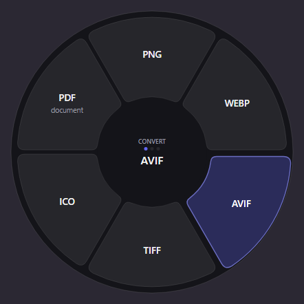
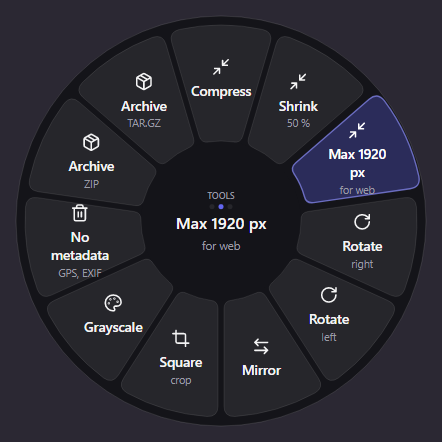
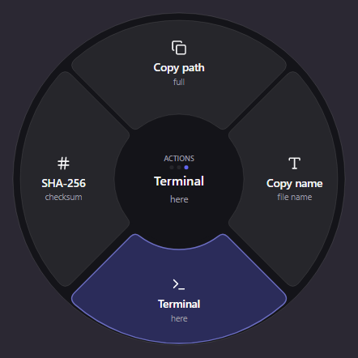
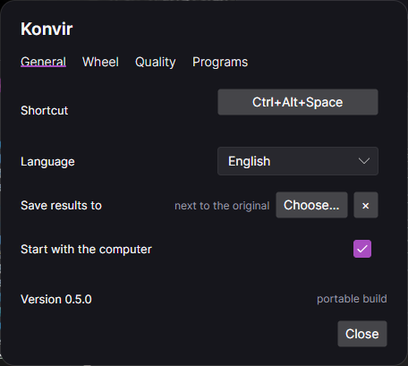



# Konvir

**A file converter that lives on a radial menu.**
Select files, press the shortcut, pick a slice.

English · [Русский](README.ru.md)

Images, audio, video, PDF, documents, spreadsheets, slides, subtitles and archives. Everything
runs on your machine — no file is ever uploaded anywhere.

## How it works

1. Select files in Explorer or on the desktop.
2. Press `Ctrl+Alt+Space`. The wheel opens under the cursor, showing only what fits the selection.
3. Click a slice. Progress appears in a small panel in the corner, and the result lands next to
   the original or in a folder you chose. The panel leaves five seconds after the last job, green
   or red, draining a bar so you can see it going.

With nothing selected the wheel opens empty, as a target: drop files on it and it fills in.

## Three wheels

`Tab` or the scroll wheel switches between them. A wheel with nothing to offer is never shown, so
every slice you can reach does something.

Right-click a slice to move it to the front of its wheel or take it off entirely. The wheel is
its own settings screen for this: the slice you want gone is the one already under the pointer.
Hidden slices are listed in the settings, where they can be put back.

| Convert | Tools | Actions |
|:--:|:--:|:--:|
|  |  |  |
| One format into another | Compress, resize, rotate, strip metadata, archive | Copy path, copy name, open a terminal, SHA-256 |

## Your own slices

A preset is a conversion you describe once and then reach from the wheel: "Web 1920" as JPEG at
quality 82 with the metadata stripped, or "Podcast" as 128 kbit/s MP3. Build them in the settings;
each becomes a slice of its own, named by you.

A preset that changes the format lands on the convert wheel. One that keeps the format — half
size, grayscale, metadata removed — lands on tools, because it edits the file rather than turning
it into something else. Results are named after the preset: `photo (Web 1920).jpg`.

## Formats

| Kind | In | Out |
|---|---|---|
| Images | JPG, PNG, WEBP, HEIC, TIFF, AVIF, BMP, GIF, SVG, ICO and 25 raw formats | JPG, PNG, WEBP, AVIF, TIFF, ICO, PDF |
| Audio | MP3, M4A, AAC, WAV, FLAC, OGG, OPUS, AIFF, WMA | MP3, M4A, WAV, FLAC, OGG, OPUS, AIFF |
| Video | MP4, MOV, MKV, WEBM, AVI, WMV, FLV, MPG, 3GP, TS | MP4, MOV, MKV, WEBM, GIF, MP3 |
| Documents | DOCX, DOC, ODT, RTF, MD, TXT, HTML, EPUB | DOCX, PDF, ODT, MD, HTML, TXT, EPUB, RTF |
| Spreadsheets | XLSX, XLSM, XLS, ODS, CSV, TSV | XLSX, CSV, TSV, ODS, PDF |
| Slides | PPTX, PPT, ODP | PDF, PNG, JPG, PPTX, ODP |
| Subtitles | SRT, VTT | SRT, VTT, TXT |
| Archives | ZIP, TAR, GZ, BZ2, XZ, RAR, 7Z | ZIP, TAR, TAR.GZ |
| PDF | PDF | PNG, JPG, DOCX, TXT, MD, HTML, EPUB |

## Settings

Five tabs: general, the wheel's own slices, the quality knobs each conversion uses, the external
programs, and your licence. Changes take effect as you make them — there is no OK button to
forget.

To change the shortcut, click it and press the combination you want. Anything with at least one
modifier is accepted; if another program already owns it, the window says so instead of leaving
you with a shortcut that does nothing.

## External programs

Media and office conversions are done by three well-known programs, and Konvir runs them as
separate command-line processes:

| Program | Needed for | How to get it |
|---|---|---|
| FFmpeg | Audio and video | The **Install** button downloads it, checksum verified |
| Pandoc | Documents and e-books | The **Install** button, through winget |
| LibreOffice | DOCX, XLSX, PPTX and ODF | The **Install** button, through winget |

Konvir never ships these programs: you install them, on your machine, from their own publishers.
That separation is deliberate and is kept on purpose: their licences stay with them.

Everything else — images, PDF, spreadsheets, subtitles, archives — works with nothing installed.

## Installing

Windows builds are published on the
[Releases page](https://github.com/KROWIEL/konvir/releases): an installer and a portable archive.
The installer puts Konvir in `%LOCALAPPDATA%\Konvir` and can start it with the computer; the
settings window checks for newer versions.

The code is not signed yet, so SmartScreen will warn on first run.

## Platform support

| | Shortcut | Tray | File manager selection |
|---|:--:|:--:|:--:|
| Windows 10/11 | yes | yes | Explorer |
| macOS | planned | planned | planned |
| Linux | planned | planned | planned |

The conversion core and the interface are already cross-platform; what is missing is the native
layer each system needs.

## Buying

Konvir converts everything for 14 days, with nothing to sign up for. After that it needs a key,
which you enter under **Settings → Licence** along with the address you bought it with. One key
covers every computer you use yourself, and it does not expire.

Keys are checked on your own machine, so Konvir works offline and keeps working if this site
ever goes away.

## Licence

Konvir is proprietary software. Its conversion core began as a fork of
[krllmrzv/Sweetch](https://github.com/krllmrzv/Sweetch) (MIT); the required copyright notices and
every dependency's licence are kept in [`LICENSE`](LICENSE) and
[`THIRD-PARTY-NOTICES.md`](THIRD-PARTY-NOTICES.md).
