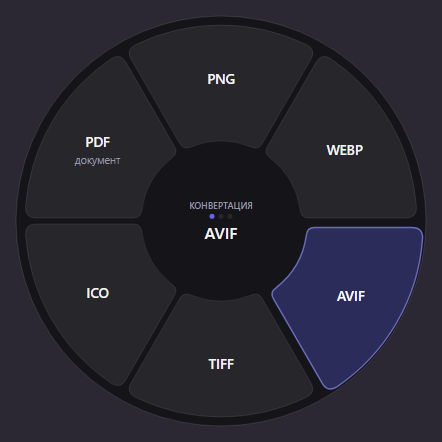
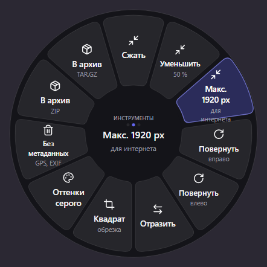
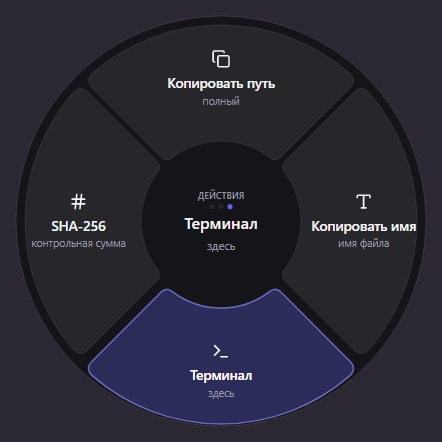
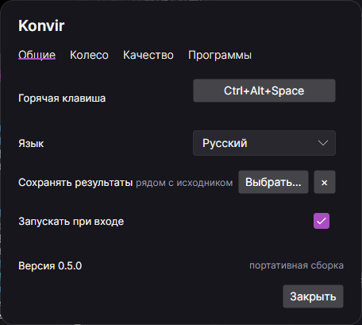



# Konvir

**Конвертер файлов, живущий в круговом меню.**
Выделил файлы, нажал сочетание клавиш, выбрал сектор.

[English](README.md) · Русский

Изображения, аудио, видео, PDF, документы, таблицы, презентации, субтитры и архивы. Всё считается
на вашей машине — ни один файл никуда не отправляется.

## Как это работает

1. Выделите файлы в Проводнике или на рабочем столе.
2. Нажмите `Ctrl+Alt+Space`. Колесо откроется под курсором и покажет только то, что подходит
   выделенному.
3. Щёлкните сектор. Ход работы видно в маленькой панели в углу, результат появится рядом с
   исходником или в выбранной вами папке. Через пять секунд после последней задачи панель
   уходит — зелёная или красная, с убывающей полоской, чтобы было видно, сколько осталось.

Если ничего не выделено, колесо открывается пустым — как цель: перетащите на него файлы, и оно
заполнится.

## Три колеса

Между ними переключают `Tab` и колёсико мыши. Колесо, которому нечего предложить, не показывается
вовсе, так что любой доступный сектор что-то делает.

Правый клик по сектору двигает его в начало колеса или убирает совсем. Колесо здесь само себе
окно настроек: нужный сектор и так уже под курсором. Скрытые перечислены в настройках, оттуда их
можно вернуть.

| Конвертация | Инструменты | Действия |
|:--:|:--:|:--:|
|  |  |  |
| Один формат в другой | Сжать, уменьшить, повернуть, убрать метаданные, упаковать | Копировать путь и имя, открыть терминал, SHA-256 |

## Свои секторы

Пресет — это конвертация, описанная один раз и доступная с колеса: «Web 1920» как JPEG качества
82 с вычищенными метаданными или «Подкаст» как MP3 128 кбит/с. Создаются в настройках, каждый
становится отдельным сектором с вашим названием.

Пресет, меняющий формат, попадает на колесо конвертации. Пресет, сохраняющий формат — половинный
размер, оттенки серого, без метаданных, — на колесо инструментов: он правит файл, а не превращает
его в другой. Результат называется по пресету: `photo (Web 1920).jpg`.

## Форматы

| Тип | Из | В |
|---|---|---|
| Изображения | JPG, PNG, WEBP, HEIC, TIFF, AVIF, BMP, GIF, SVG, ICO и 25 raw-форматов | JPG, PNG, WEBP, AVIF, TIFF, ICO, PDF |
| Аудио | MP3, M4A, AAC, WAV, FLAC, OGG, OPUS, AIFF, WMA | MP3, M4A, WAV, FLAC, OGG, OPUS, AIFF |
| Видео | MP4, MOV, MKV, WEBM, AVI, WMV, FLV, MPG, 3GP, TS | MP4, MOV, MKV, WEBM, GIF, MP3 |
| Документы | DOCX, DOC, ODT, RTF, MD, TXT, HTML, EPUB | DOCX, PDF, ODT, MD, HTML, TXT, EPUB, RTF |
| Таблицы | XLSX, XLSM, XLS, ODS, CSV, TSV | XLSX, CSV, TSV, ODS, PDF |
| Презентации | PPTX, PPT, ODP | PDF, PNG, JPG, PPTX, ODP |
| Субтитры | SRT, VTT | SRT, VTT, TXT |
| Архивы | ZIP, TAR, GZ, BZ2, XZ, RAR, 7Z | ZIP, TAR, TAR.GZ |
| PDF | PDF | PNG, JPG, DOCX, TXT, MD, HTML, EPUB |

## Настройки

Пять вкладок: общие настройки, свои секторы колеса, параметры качества для каждого вида
конвертации, внешние программы и лицензия. Изменения применяются сразу — кнопки «ОК», которую
можно забыть нажать, здесь нет.

Чтобы сменить сочетание, щёлкните по нему и нажмите нужные клавиши. Подойдёт любое сочетание
хотя бы с одним модификатором; если его уже занимает другая программа, окно об этом скажет, а не
оставит вас с горячей клавишей, которая ничего не делает.

## Внешние программы

Медиа и офисные форматы обрабатывают три известные программы, и Konvir запускает их как отдельные
процессы командной строки:

| Программа | Нужна для | Как получить |
|---|---|---|
| FFmpeg | Аудио и видео | Кнопка **Установить** скачает её с проверкой контрольной суммы |
| Pandoc | Документы и электронные книги | Кнопка **Установить**, через winget |
| LibreOffice | DOCX, XLSX, PPTX и ODF | Кнопка **Установить**, через winget |

Konvir их не распространяет: вы ставите их себе сами и от их собственных авторов. Это разделение
сделано намеренно и сохраняется осознанно: их лицензии остаются при них.

Всё остальное — изображения, PDF, таблицы, субтитры, архивы — работает без единой установки.

## Установка

Сборки для Windows лежат на
[странице релизов](https://github.com/KROWIEL/konvir/releases): установщик и портативный архив.
Установщик кладёт Konvir в `%LOCALAPPDATA%\Konvir` и умеет запускать его вместе с системой, а окно
настроек проверяет обновления.

Код пока не подписан, поэтому при первом запуске SmartScreen предупредит.

## Поддержка платформ

| | Горячая клавиша | Трей | Выделение в файловом менеджере |
|---|:--:|:--:|:--:|
| Windows 10/11 | есть | есть | Проводник |
| macOS | в планах | в планах | в планах |
| Linux | в планах | в планах | в планах |

Ядро конвертации и интерфейс уже кроссплатформенные; не хватает нативного слоя под каждую систему.

## Покупка

14 дней Konvir конвертирует всё без ограничений и без регистрации. Дальше нужен ключ.

Ключ выдаётся на один компьютер. В **Настройках → Лицензия** показан код устройства этого
компьютера — отправьте его вместе с заказом, а пришедший в ответ ключ введите там же, рядом с
почтой, на которую он куплен. Ключ не истекает.

Ключи проверяются прямо на вашей машине, поэтому Konvir работает без интернета и продолжит
работать, даже если этот сайт когда-нибудь исчезнет. О вашем компьютере никуда ничего не
уходит: код устройства — это хеш, а то, из чего он сделан, машину не покидает.

## Лицензия

Konvir — проприетарное программное обеспечение. Его ядро конвертации выросло из форка
[krllmrzv/Sweetch](https://github.com/krllmrzv/Sweetch) (MIT); обязательные уведомления об
авторских правах и лицензии всех зависимостей сохранены в [`LICENSE`](LICENSE) и
[`THIRD-PARTY-NOTICES.md`](THIRD-PARTY-NOTICES.md).
