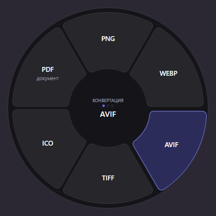
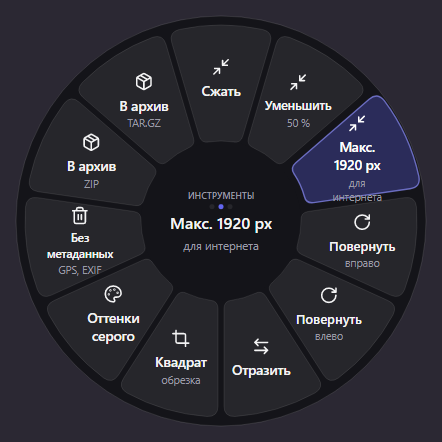
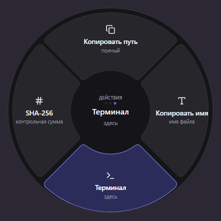
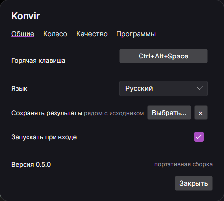

<div align="center">



# Konvir

### Любой файл в другой формат за два щелчка — прямо там, где он лежит.

Выделил файлы, нажал сочетание клавиш, выбрал сектор на колесе. Вот и вся программа.

**Полностью бесплатно.** Без пробного периода, ключей, рекламы, регистрации и загрузки файлов в облако.

[](https://github.com/KROWIEL/konvir/releases/latest/download/Konvir-win-Setup.exe)
[](https://github.com/KROWIEL/konvir/releases/latest/download/Konvir-osx-Setup.pkg)

[](https://github.com/KROWIEL/konvir/releases/latest)
[](https://github.com/KROWIEL/konvir/releases)


[Сайт](https://krowiel.github.io/konvir/) · [English](README.md) · Русский

</div>

## Почему Konvir

- **Бесплатно всё.** Каждый формат и каждая функция — без пробного периода, платной версии,
  лицензионного ключа и регистрации.
- **Файлы остаются у вас.** Всё считается на вашем компьютере: никакого облака, аккаунта и
  загрузки на сервер. В интернет Konvir ходит только проверить собственные обновления и скачать
  FFmpeg или Pandoc, когда вы сами нажмёте кнопку.
- **Жест вместо программы.** Не нужно открывать окно, перетаскивать в него файлы и листать список
  из сотни форматов. Колесо показывает только то, что подходит выделенному.
- **Девять видов файлов.** Изображения (включая HEIC и 25 raw-форматов камер), аудио, видео, PDF,
  Word, Excel, PowerPoint, электронные книги, субтитры и архивы.
- **Сто файлов так же просто, как один.** Выделите папку фотографий и сконвертируйте всё разом:
  задачи встают в очередь и выполняются в фоне.
- **Свои секторы.** Сохраните конвертацию один раз — «JPEG для сайта, без метаданных» — и она
  получит собственный сектор на колесе.
- **Папки, которые конвертируют сами.** Укажите Konvir папку, и всё, что в неё попадёт, будет
  сконвертировано без вашего участия.
- **Не мешает.** Живёт в трее или строке меню, следует светлой или тёмной теме системы, говорит
  по-русски и по-английски и обновляется сам.

## Как это работает

1. Выделите файлы в Проводнике, в Finder или на рабочем столе.
2. Нажмите `Ctrl+Alt+Space` (на Mac — `⇧⌘Пробел`). Колесо откроется под курсором и покажет только
   то, что подходит выделенному.
3. Щёлкните сектор. Ход работы видно в маленькой панели в углу, результат появится рядом с
   исходником или в выбранной вами папке. Через пять секунд после последней задачи панель
   уходит — зелёная или красная, с убывающей полоской, чтобы было видно, сколько осталось.

Если ничего не выделено, колесо открывается пустым — как цель: перетащите на него файлы, и оно
заполнится.

## Три колеса

Между ними переключают `Tab` и колёсико мыши. Колесо, которому нечего предложить, не показывается
вовсе, так что любой доступный сектор что-то делает.

| Конвертация | Инструменты | Действия |
|:--:|:--:|:--:|
|  |  |  |
| Один формат в другой | Сжать, уменьшить, повернуть, убрать метаданные, упаковать | Копировать путь и имя, открыть терминал, SHA-256 |

Правый клик по сектору двигает его в начало колеса или убирает совсем. Колесо здесь само себе
окно настроек: нужный сектор и так уже под курсором. Скрытые перечислены в настройках, оттуда их
можно вернуть.

## Свои секторы

Пресет — это конвертация, описанная один раз и доступная с колеса: «Web 1920» как JPEG качества
82 с вычищенными метаданными или «Подкаст» как MP3 128 кбит/с. Создаются в настройках, каждый
становится отдельным сектором с вашим названием.

Пресет, меняющий формат, попадает на колесо конвертации. Пресет, сохраняющий формат — половинный
размер, оттенки серого, без метаданных, — на колесо инструментов: он правит файл, а не превращает
его в другой. Результат называется по пресету: `photo (Web 1920).jpg`.

## Папки, которые конвертируют сами

Скажите Konvir, для чего папка, — «каждое фото здесь становится JPEG», «каждое видео — MP4», — и он
будет делать это со всем, что туда попадёт, с подпапками или без. Результаты ложатся в папку
`Konvir` внутри неё, исходники не трогаются. Файл берётся, только когда он доехал целиком:
недокачанную загрузку или медленное копирование Konvir подождёт.

## Форматы

| Тип | Из | В |
|---|---|---|
| Изображения | JPG, PNG, WEBP, HEIC, TIFF, AVIF, BMP, GIF, SVG, ICO и 25 raw-форматов | JPG, PNG, WEBP, AVIF, TIFF, ICO, PDF |
| Аудио | MP3, M4A, AAC, WAV, FLAC, OGG, OPUS, AIFF, WMA | MP3, M4A, WAV, FLAC, OGG, OPUS, AIFF |
| Видео | MP4, MOV, MKV, WEBM, AVI, WMV, FLV, MPG, 3GP, TS | MP4, MOV, MKV, WEBM, GIF, MP3 |
| Документы | DOCX, DOC, ODT, RTF, MD, TXT, HTML, EPUB | DOCX, PDF, ODT, MD, HTML, TXT, EPUB, RTF |
| Таблицы | XLSX, XLSM, XLS, ODS, CSV, TSV | XLSX, CSV, TSV, ODS, PDF |
| Презентации | PPTX, PPT, ODP | PDF, PNG, JPG, PPTX, ODP |
| Субтитры | SRT, VTT | SRT, VTT, TXT |
| Архивы | ZIP, TAR, GZ, BZ2, XZ, RAR, 7Z | ZIP, TAR, TAR.GZ |
| PDF | PDF | PNG, JPG, DOCX, TXT, MD, HTML, EPUB |

Не хватает нужного формата? [Попросите](https://github.com/KROWIEL/konvir/issues/new?template=idea.yml).

## Настройки

<div align="center">

</div>

Пять вкладок: общие настройки, свои секторы колеса, параметры качества для каждого вида
конвертации, внешние программы и папки наблюдения. Изменения применяются сразу — кнопки «ОК»,
которую можно забыть нажать, здесь нет.

Чтобы сменить сочетание, щёлкните по нему и нажмите нужные клавиши. Подойдёт любое сочетание
хотя бы с одним модификатором; если его уже занимает другая программа, окно об этом скажет, а не
оставит вас с горячей клавишей, которая ничего не делает.

## Внешние программы

Медиа и офисные форматы обрабатывают три известные программы, и Konvir запускает их как отдельные
процессы командной строки:

| Программа | Нужна для | Как получить |
|---|---|---|
| FFmpeg | Аудио и видео | Кнопка **Установить** скачает её с проверкой контрольной суммы |
| Pandoc | Документы и электронные книги | Кнопка **Установить**: в Windows через winget, в macOS скачает с проверкой контрольной суммы |
| LibreOffice | DOCX, XLSX, PPTX и ODF | Windows: кнопка **Установить**, через winget. macOS: **Скачать…** откроет libreoffice.org |

Konvir их не распространяет: вы ставите их себе сами и от их собственных авторов. Это разделение
сделано намеренно и сохраняется осознанно: их лицензии остаются при них.

Всё остальное — изображения, PDF, таблицы, субтитры, архивы — работает без единой установки.

## Установка

Все сборки лежат на [странице релизов](https://github.com/KROWIEL/konvir/releases): установщик и
портативный архив для каждой системы. Новые версии Konvir находит сам и ставит при следующем
закрытии, сохраняя ваши настройки.

### Windows

Windows 10 или 11. Установщик `Konvir-win-Setup.exe` кладёт Konvir в `%LOCALAPPDATA%\Konvir`, не
просит прав администратора и умеет запускать его вместе с системой.

Ещё Konvir ждёт проверки в диспетчере пакетов Windows. Когда его примут, winget поставит его и
сам сверит загрузку с контрольной суммой:

```
winget install Konvir.Konvir
```

### Про предупреждение SmartScreen

Если скачать установщик руками, Windows скажет «Система Windows защитила ваш компьютер».
Нажмите **Подробнее**, затем **Выполнить в любом случае**.

Konvir пока не подписан сертификатом. Говорим прямо, чтобы вы не гадали: сертификат стоит
несколько сотен долларов в год и — об этом обычно умалчивают — предупреждение всё равно не
убирает. SmartScreen показывает его и для подписанных установщиков, пока у файла не накопится
история загрузок.

А пока в каждом релизе указана SHA-256 каждого файла — можно проверить, что скачалось именно то,
что мы собрали.

```powershell
Get-FileHash .\Konvir-win-Setup.exe -Algorithm SHA256
```

### macOS

macOS 13 и новее на Apple Silicon (M1 и старше). Установщик — `Konvir-osx-Setup.pkg`. Konvir
живёт в строке меню, а не в Dock; горячая клавиша — ⇧⌘Пробел.

Konvir пока не нотаризован Apple, поэтому в первый раз macOS откажется его открывать. Откройте
**Системные настройки → Конфиденциальность и безопасность** и нажмите **Все равно открыть**.
Когда вы впервые откроете колесо на файлах, выделенных в Finder, macOS спросит, можно ли Konvir
управлять Finder: так он узнаёт, какие файлы выделены. Если ставить Konvir для всех
пользователей, первое обновление один раз попросит пароль администратора.

```sh
shasum -a 256 Konvir-osx-Setup.pkg
```

## Поддержка платформ

| | Горячая клавиша | Трей | Выделение в файловом менеджере |
|---|:--:|:--:|:--:|
| Windows 10/11 | есть | есть | Проводник |
| macOS 13+ | есть | строка меню | Finder |
| Linux | в работе | в работе | в работе |

Ядро конвертации и интерфейс уже кроссплатформенные; Linux не хватает нативного слоя.

## Идеи и ошибки

Konvir растёт из того, о чём просят. Не хватает формата, нужен сектор на каждый день, колесо
должно вести себя иначе — скажите:

- [Предложить идею](https://github.com/KROWIEL/konvir/issues/new?template=idea.yml)
- [Сообщить об ошибке](https://github.com/KROWIEL/konvir/issues/new?template=bug.yml)

Для обоих нужен бесплатный аккаунт GitHub. Уже предложенные идеи — в
[списке предложений](https://github.com/KROWIEL/konvir/issues): палец вверх под идеей помогает
сделать её раньше.

## Вопросы

**Это правда бесплатно?** Да. Нет пробного периода, который закончится, нет функций за оплату и
нет ключа, который надо вводить. Пользуйтесь дома или на работе, на скольких угодно компьютерах.

**Это открытый код?** Нет. Программа бесплатная, исходники закрыты. Здесь публикуются релизы, их
контрольные суммы и лицензии всего, из чего Konvir собран.

**Работает без интернета?** Да. Когда FFmpeg, Pandoc или LibreOffice установлены, интернет Konvir
не нужен вовсе.

**Обновление сбросит настройки?** Нет. Обновления сохраняют горячую клавишу, пресеты, папки
наблюдения и установленные программы, а после удаления настройки остаются на следующий раз.

## Из чего сделан

| | |
|---|---|
| Платформа | [.NET 10](https://dotnet.microsoft.com), самодостаточная сборка под каждую систему |
| Интерфейс | [Avalonia](https://avaloniaui.net), колесо нарисовано вручную на её холсте |
| Установщик и обновления | [Velopack](https://velopack.io) |
| Изображения | [ImageMagick](https://imagemagick.org) через Magick.NET |
| PDF | PDFium, PdfPig, PDFsharp |
| Таблицы и архивы | ClosedXML, ExcelDataReader, SharpCompress |
| Аудио, видео, документы | [FFmpeg](https://ffmpeg.org), [Pandoc](https://pandoc.org) и [LibreOffice](https://www.libreoffice.org) — отдельными программами |

## Лицензия

Konvir можно бесплатно скачивать и использовать для любых целей и на любом числе компьютеров;
продавать его и распространять изменённым нельзя. Полные условия — в [`LICENSE`](LICENSE).

Его ядро конвертации выросло из форка [krllmrzv/Sweetch](https://github.com/krllmrzv/Sweetch)
(MIT); обязательные уведомления об авторских правах и лицензии всех зависимостей сохранены в
[`THIRD-PARTY-NOTICES.md`](THIRD-PARTY-NOTICES.md).
